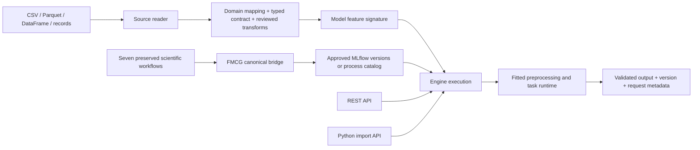

# Tabular ML Integration Engine — FMCG Sales Intelligence

A modular Python application for connecting tabular data to explicitly compatible,
versioned models. FMCG is the scientific reference application. A small customer
churn example demonstrates reuse outside retail.

This is a local engineering demonstration, not a certified production service.
Synthetic examples do not establish business effectiveness or model accuracy.

## Quick start without private data

Use Python 3.13. Run from the repository root. On Windows use
`.venv\Scripts\python.exe` after creating the environment; on POSIX use
`.venv/bin/python`. Activation is optional.

```bash
python -m venv .venv
# Activate the environment for your shell, then:
python -m pip install -e '.[dev]'
python -m fmcg_sales_intelligence.integrations.demo --output .demo
python -m uvicorn fmcg_sales_intelligence.integrations.demo:create_demo_app --factory --host 127.0.0.1 --port 8000
```

The demo generates deterministic CSV/Parquet customer inputs, trains two tiny
sklearn Pipelines, and compares Python and REST results. It writes
`.demo/evidence.json`; generated data/models are not committed. It needs neither
PostgreSQL nor DVC/Google Drive. Model names are `customer-churn` and `demand-demo`,
version `1`. These fixtures do not replace the canonical FMCG models.

```bash
curl http://127.0.0.1:8000/api/v1/models
curl http://127.0.0.1:8000/api/v1/models/customer-churn/schema
curl -X POST http://127.0.0.1:8000/api/v1/models/customer-churn/inferences -H 'Content-Type: application/json' -d '{"version":"1","domain":"customer-retention","rows":[{"months":12,"fee":75,"plan":"monthly"}]}'
```

PowerShell can use `Invoke-RestMethod` with the same URL and a JSON body.
Swagger is at [localhost docs](http://127.0.0.1:8000/docs).
Engine readiness is `/api/v1/runtime/ready`; process liveness is `/health`.
`/ready` reports **canonical FMCG** readiness and intentionally remains 503 when
those separate artifacts are absent.

## Architecture and boundaries



| Layer | Implementation | Responsibility |
|---|---|---|
| Reusable core | `src/fmcg_sales_intelligence/engine/` | Typed feature contracts, domain injection, versions, bounded execution, output validation |
| Integrations | `integrations/` | REST router, MLflow, explicit artifact trust, demo and FMCG bridge |
| FMCG product | `product/` | Business identifiers, eleven operational contracts, analytical publication, BI, legacy API |
| Scientific work | `science/`, `config/modeling/` | Training, evaluation, time splits, embargoes, metrics and frozen experiments |
| Data engineering | `pipelines/`, `platform/dbt/` | Generation, PostgreSQL, DuckDB/dbt marts, validation |
| Optional operations | `platform/`, main Compose | MLflow, monitoring, Kafka replay, Airflow DAG source |

The core imports no FMCG product/science code or web framework. Domain packs and
runtime objects are injected by reviewed application code. File mapping does not
infer meaning, create missing features, or remove unknown columns silently.
Numeric string coercion is opt-in. Booleans are not numbers. Nulls require an
explicit nullable contract. Categories, finite values and row keys are validated.
The fitted Pipeline owns preprocessing; inference never fits it. Any feature
construction involving time must obey domain-specific availability cutoffs.
There is no automatic point-in-time join engine.

## Supported capabilities

| Capability | Status |
|---|---|
| CSV, Parquet, DataFrame, record batches | Supported; SDK local file paths only |
| Declarative rename, strict coercion, category/null rules, scaling | Supported |
| Complex domain feature construction | Operator-injected Python callable; no HTTP code/module loading |
| Regression, classification, scoring, cluster assignment runtime | Predictor interface; demo covers regression/classification |
| Native MLflow sklearn Pipeline registration and version loading | Optional, tested with local SQLite registry |
| Canonical forecasting and classification | Shared engine bridge and legacy wrappers; operator approval required |
| Survival, anomaly, association and promotion | Existing offline scientific jobs/publication; no universal online predict claim |
| Segmentation | Existing exploratory frozen membership endpoint |
| PostgreSQL, DuckDB/dbt | Preserved FMCG warehouse and reporting |
| Kafka | Optional experimental replay to PostgreSQL, **not streaming inference** |
| Airflow | DAG source retained; no service started by Compose |
| Authentication, tenant isolation, HA, model sandbox | Not implemented; bind locally / use external gateway for deployment |

## Python integration and model registration

```python
from fmcg_sales_intelligence.integrations.demo import build_demo

engine, pipeline, signature, training_frame = build_demo()
result = engine.infer(
    "customer-churn",
    [{"months": 12, "fee": 75, "plan": "monthly"}],
    version="1", domain="customer-retention",
)
assert result["metadata"]["version"] == "1"
```

`Engine` is the lightweight import API used by REST. A caller can register its own
fitted Pipeline with `MemoryRegistry.register(Model(..., Predictor(pipeline)))`.
This catalog lives only in one process and does not implement a second persistent
model registry. If more than one version exists, callers must specify a version.
There is no ambiguous lexicographic "latest".

For persistent versioning use native MLflow signatures and Model Registry:

```bash
python -m pip install -e '.[dev,mlflow]'
python -m fmcg_sales_intelligence.integrations.demo --output .demo --mlflow-uri sqlite:///demo-mlflow.db
```

```python
from fmcg_sales_intelligence.engine import Engine
from fmcg_sales_intelligence.integrations.mlflow import MLflowRegistry, register_sklearn

uri = register_sklearn(
    "sqlite:///demo-mlflow.db", "my-reviewed-model", pipeline, signature,
    training_frame.head(4), task="classification",
)
registry = MLflowRegistry("sqlite:///demo-mlflow.db", {uri: signature})
result = Engine(registry).infer("my-reviewed-model", training_frame.head(4), version=uri.split("/")[-1])
```

Registration requires a fitted sklearn Pipeline. Native MLflow input/output
signatures and the stricter engine contract travel with it. Deployment config
approves immutable `models:/name/numeric-version` URIs, not aliases or arbitrary
request paths. Initialize one MLflow tracking/registry URI per server process;
MLflow configuration is process-global. The adapter caches startup load outcomes;
restart after fixing an unavailable artifact. Protect the registry and artifact
store from untrusted writers. Python serialization may execute code; approval is
a provenance decision, not sandboxing. There is no HTTP registration/upload API.
See [MLflow registry documentation](https://mlflow.org/docs/latest/registry/).

## Add a domain

Create a `DomainPack` with a `Signature`, an external-to-canonical `mapping`,
optional numeric `scales`, and optionally a reviewed `transform(frame)` callable.
Register it with `engine.domains.register(pack)`. No engine changes are needed.
`DomainPack.from_yaml(path)` accepts `name`, `version`, `signature`, `mapping`,
and `scales`; it deliberately rejects code/module configuration. See
[domain configuration](config/domains/customer_retention/engine.yaml).

Validation runs before domain transformations and again against the model
signature afterward. Target/future fields must appear in `Signature.forbidden`.
Training code must use the same feature transformation and cutoff policy. Avoid
passing outcome columns; extra columns are rejected rather than discarded.

## REST contract

| Endpoint | Behavior |
|---|---|
| `GET /api/v1/models` | Deployed models, schemas, versions and readiness |
| `GET /api/v1/models/{name}?version=1` | Exact version metadata |
| `GET /api/v1/models/{name}/schema?version=1` | Input signature |
| `POST /api/v1/models/{name}/validate` | Same rows/version/domain body as inference |
| `POST /api/v1/models/{name}/inferences` | Predictions and execution metadata |
| `GET /api/v1/domains` | Registered executable domain packs |
| `GET /api/v1/domain-packs` | Historical FMCG profile metadata |
| `GET /api/v1/runtime/ready` | Generic deployment readiness |

Invalid input: 422; unknown/unapproved model/version: 404; registered unavailable
model: 503; conflicting registration: 409; unexpected execution failure: 500 with
sanitized message. Requests have identifiers; exceptions are logged server-side.
Batches are limited to 1,000 rows and HTTP bodies to 2 MB of actual bytes, including
chunked bodies. `/metrics` exposes request counts/latency and inference counters.
The original forecast, stockout, segmentation, contracts, analytics and business
routes remain. `/api/v1/models` now returns generic schema-aware metadata;
`/api/v1/legacy/models` retains the old frozen metadata shape.

## Docker

Independent, artifact-free demo (no `.env` or external services):

```bash
docker compose -f docker-compose.demo.yml up -d --build --wait
docker compose -f docker-compose.demo.yml down
```

The API runs as a non-root user and binds the published port to loopback.
The main `docker-compose.yml` is the optional **FMCG infrastructure** deployment.
Copy `.env.example` to `.env` and set unique `POSTGRES_PASSWORD` and
`GRAFANA_ADMIN_PASSWORD`. Empty values fail configuration. Do not commit `.env`.

Profiles: `core` (canonical API/publication), `mlops` (MLflow), `observability`
(Grafana/Prometheus/API), `streaming` (Kafka/UI), `full-demo` (canonical stack,
excluding Kafka). PostgreSQL is unprofiled. API mounts processed features as well
as canonical models and warehouse read-only. Canonical readiness needs approved
models; these profiles do not manufacture missing frozen artifacts.
Grafana anonymous access and signup are disabled; all published ports bind to
loopback. Kafka uses local plaintext and is unsupported outside local experiments.

## Canonical scientific reproducibility

All seven experiment modules, configurations, manifests and existing results are
preserved. They use the existing science CLI and DVC stages. The default DVC remote
still requires Google Drive credentials; it is **not** required for the small demo.
The larger historical pipeline depends on donor calibration/data and warehouse
outputs. Its procedures are recorded under `docs/deployment/` and
`docs/architecture/`; historical documents are not substitutes for the verified
small-demo commands above. No claim is made that a fresh clone can reproduce the
frozen scientific metrics without their source inputs.

After obtaining and reviewing the canonical artifacts, explicitly approve them:

```bash
python -m fmcg_sales_intelligence.integrations.approve artifacts/canonical --approve-reviewed-python-artifacts
python -m uvicorn fmcg_sales_intelligence.product.api.app:app --host 127.0.0.1 --port 8000
```

Approval writes a local `trusted-artifacts.json` map of SHA-256 hashes. Replacing
an artifact invalidates approval. Mount it read-only with models; approve only
known training outputs. The engine uses the exact approved bytes for loading.
Forecast clipping, fitted preprocessing and classification thresholds are retained.
No frozen metric is presented as a production benchmark.

## Testing and limitations

```bash
python -m pip install -e '.[dev,mlflow]'
ruff check .
python -m pytest tests/unit tests/engine -q
```

CI runs lint in its own job and these artifact-independent tests in another job.
It also runs the reproducible demo with a local MLflow registry, retaining JUnit
and demo evidence on failure. `tests/canonical` preserves prior generated-data,
exact split-count and canonical artifact assertions, moved out of unit tests.
`tests/scientific`, most historical `tests/integration` and `tests/runtime` require
the separately provisioned larger FMCG datasets/artifacts/warehouse. Database tests
require a dedicated PostgreSQL instance. They are not silently treated as isolated
unit coverage. See [baseline audit](docs/architecture/modernization_baseline.md)
and [final verification](docs/architecture/modernization_verification.md).

Models and feature transforms run in-process. Operators must bound compute,
review artifacts and protect deployment configuration. This implementation has
no load-test evidence, API auth, distributed scheduling, online feature store,
probability calibration guarantee or production SLA.
