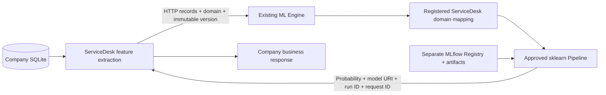

# Independent ServiceDesk → ML Engine integration

This company backend has its own Python distribution, SQLite ticket schema and
FastAPI application. Its runtime imports no platform modules; it calls the
existing ML Engine exclusively over HTTP. No reusable `engine/` code is changed.



There are three persistent services: ServiceDesk, the ML Engine, and MLflow.
A one-shot initializer generates the data, trains two Pipelines and writes an
operator-controlled approval file. An optional verification container runs tests.
The engine receives no mount of the company ticket database. The backend receives
no mount of model approvals or registry artifacts. Only HTTP carries inference
features/results between them.

## Start from a fresh clone

Requires Docker Engine and Docker Compose v2. Run from the repository root:

```bash
docker compose -f examples/external_company_integration/compose.yml up -d --build --wait --wait-timeout 240
```

No `.env`, private artifacts, credentials, DVC remote or manual database preparation
is required. The command builds independently packaged services, creates 480
synthetic tickets, trains/registers immutable versions `1` and `2`, approves those
two versions, and waits for model/runtime and backend health checks.

- ServiceDesk: [localhost:18090/docs](http://localhost:18090/docs)
- ML Engine: [localhost:18000/docs](http://localhost:18000/docs)
- MLflow: private Compose service `registry:5000`, not published to the host.

All host-published ports bind to loopback. Applications run as non-root users.
Registry storage, model approvals and company data use separate named volumes.
The registry is trusted local infrastructure, not an unauthenticated public API.

## Requests and responses

```bash
curl --fail http://127.0.0.1:18090/health
curl --fail http://127.0.0.1:18090/tickets/1
curl --fail 'http://127.0.0.1:18090/tickets/1/risk?version=1'
curl --fail 'http://127.0.0.1:18090/tickets/1/risk?version=2'
curl --fail 'http://127.0.0.1:18000/api/v1/models/servicedesk-sla?version=2'
```

PowerShell can use `Invoke-RestMethod` with these URLs. `/tickets/1/risk` defaults
to explicitly configured version `2`; it does not resolve a mutable "latest".
The business response contains `ticket_id`, a computed `sla_breach_probability`
between 0 and 1, `model_version`, `model_uri`, `model_run_id`, `request_id`, and
`reference_time`. Its request ID matches the HTTP `X-Request-ID` header and the
engine's execution metadata. Predictions are never hardcoded.

| Condition | Backend HTTP behavior |
|---|---|
| Existing ticket / approved version | 200, computed probability + provenance |
| Unknown ticket | 404 `TICKET_NOT_FOUND` |
| Invalid version syntax | 422 |
| Unknown or unapproved model version | 503 `MODEL_VERSION_UNAVAILABLE` |
| Stored ticket features rejected by model | 422 `INVALID_FEATURES` |
| Engine connection unavailable | 503 `ENGINE_UNAVAILABLE` |
| Engine read/request timeout | 504 `ENGINE_TIMEOUT` |
| Engine unavailable model | 503 `MODEL_UNAVAILABLE` |
| Unexpected upstream failure / malformed response | Sanitized 502 |

The engine's own API returns 422 for missing/extra/null/invalid-category/type or
outcome fields, and 404 for unapproved model versions. Backend runtime settings:
`ML_ENGINE_URL`, `TICKET_DATABASE`, `SLA_MODEL_VERSION`, `REFERENCE_TIME`,
`ENGINE_CONNECT_TIMEOUT` (default 2 s) and `ENGINE_REQUEST_TIMEOUT` (default 10 s).
Credentials, upstream response bodies and internal exceptions are not returned.
`/health` reports process liveness; model readiness lives at the engine's
`/api/v1/runtime/ready`. Historical FMCG `/ready` is independent of this deployment.

## Features, labels and versions

Reference time is fixed at **2026-01-15 12:00 UTC**. Tickets store creation time,
priority, tier, agent workload and status observed at that snapshot. Every ticket
is still before its SLA deadline. Runtime extraction reads the ticket record and
computes age from creation time and the reference timestamp. A mismatched snapshot
is rejected. It never reads `outcomes`, resolution time or the future breach label.

`domain.yaml` maps company fields to the model contract:

| Company feature | Model feature |
|---|---|
| `hours_open` | `ticket_age_hours` |
| `urgency` | `priority` |
| `account_level` | `customer_tier` |
| `assigned_agent_open_tickets` | `agent_workload` |
| `state` | `ticket_status` |
| `sla_hours` | `sla_target_hours` |

`DomainPack.from_yaml` and `DomainRegistry.register` are existing extension points.
`engine_service.py` injects these and the existing `MLflowRegistry` into the
existing platform API factory. Company code remains outside the platform package.

`generate.py` uses seed 1701. `train.py` fits a ColumnTransformer with StandardScaler
and OneHotEncoder, followed by LogisticRegression. Versions 1 and 2 differ in
regularization; each is independently fitted and logged using the existing
`register_sklearn` integration, native MLflow input/output signatures, task
metadata and immutable artifacts. The approval file lists only exact
`models:/servicedesk-sla/1` and `/2` URIs. It is not a second registry.

Initialization is repeatable: existing compatible approvals are validated without
creating duplicate versions. A changed training-source fingerprint fails clearly
and requires an explicit reset of this demo's data. No existing registry history
is rewritten. No unsafe upload or arbitrary deserialization endpoint is added.

## Verify

After startup:

```bash
docker compose -f examples/external_company_integration/compose.yml --profile verification run --build --rm verify
docker compose -f examples/external_company_integration/compose.yml exec -T servicedesk python -c "import importlib.util; assert importlib.util.find_spec('fmcg_sales_intelligence') is None"
docker compose -f examples/external_company_integration/compose.yml run --rm initialize
```

Tests use real TCP/HTTP between separate services, not FastAPI TestClient or mocked
HTTP transport. They compare database-derived predictions with Python/native
MLflow-loaded Pipeline predictions, mutate a private database copy to demonstrate
input sensitivity, reject schemas and unapproved versions, exercise connection/
read failures, and verify deterministic generation/retraining. The negative
approval test creates registry version `3` pointing to an existing artifact;
it deliberately remains undeployed and denied. Version 3 is a test control,
not a third trained model or an automatic approval.

Local Python alternative for developers with platform test/MLflow dependencies:

```bash
python -m pip install -e '.[dev,mlflow]'
python -m pip install -e examples/external_company_integration/backend
python -m pytest examples/external_company_integration/tests -q
```

That test fixture creates temporary databases and starts separate MLflow, engine
and backend HTTP processes. It does not need existing DVC/warehouse artifacts.
Existing platform checks remain `python -m pytest tests/unit tests/engine -q`.
The existing churn Docker check and the new ServiceDesk Docker check run in CI.

Stop while retaining data, or explicitly reset this demo's synthetic volumes:

```bash
docker compose -f examples/external_company_integration/compose.yml down
# Reset only this dedicated demonstration's data and registry:
docker compose -f examples/external_company_integration/compose.yml down -v
```

## Limits

This is a deterministic integration demonstration, not a validated support model
or a production service. Training uses synthetic outcomes; no real-world accuracy,
calibration or capacity claim is made. The fixed snapshot is deliberate and must
be replaced by a point-in-time feature policy for a live company deployment.
There is no user authentication, multitenancy, HA, registry access control inside
the private network, automatic approvals, scheduler, Kafka or frontend.
See [verification report](VERIFICATION.md) for actual execution evidence.
